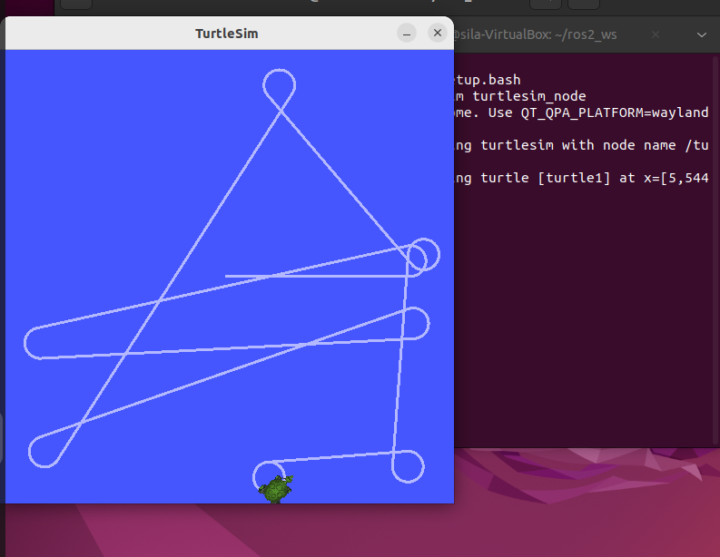
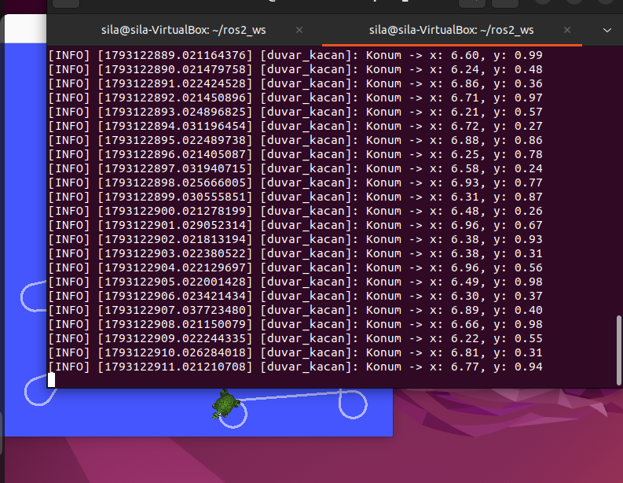

# turtle_duvar_py - Duvardan Kacan Kaplumbaga

ROS 2 Humble ile yazilmis, turtlesim'deki kaplumbaganin duvara yaklasinca yon degistirdigi bir Python paketi.

## Nasil calisir?
- **Abone:** /turtle1/pose konusunu dinler, x ve y degerlerini alir.
- **Yayinci:** /turtle1/cmd_vel konusuna Twist mesaji yayinlayarak kaplumbagayi ileri surer.
- **Duvardan kacis:** x veya y degeri 1.0'dan kucuk ya da 10.0'dan buyukse kaplumbaga durup merkeze dogru doner, sonra tekrar ilerler.
- **Log:** Konum saniyede bir get_logger().info() ile yazdirilir.
- **Bonus:** hiz, donus_hizi, alt_sinir, ust_sinir degerleri parametredir.

## Kurulum
```bash
cd ~/ros2_ws/src
git clone https://github.com/SilaYaren/turtle_duvar_py.git
cd ~/ros2_ws
colcon build --packages-select turtle_duvar_py
source install/setup.bash
```

## Calistirma
Terminal 1:
```bash
ros2 run turtlesim turtlesim_node
```

Terminal 2:
```bash
ros2 run turtle_duvar_py duvar_kacan
```

Parametreli calistirma:
```bash
ros2 run turtle_duvar_py duvar_kacan --ros-args -p hiz:=2.0 -p alt_sinir:=1.5
```

## Ekran goruntuleri


